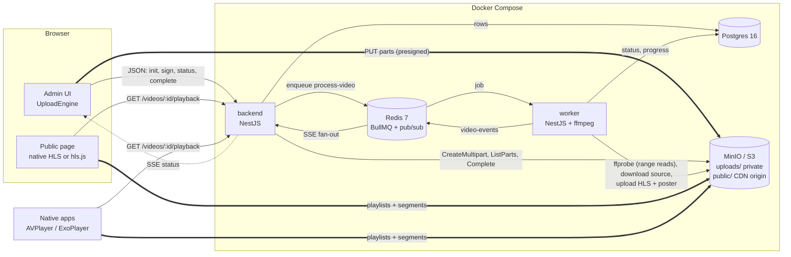
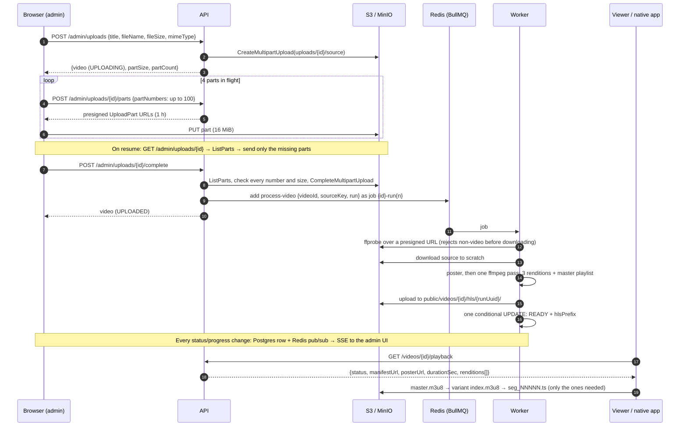
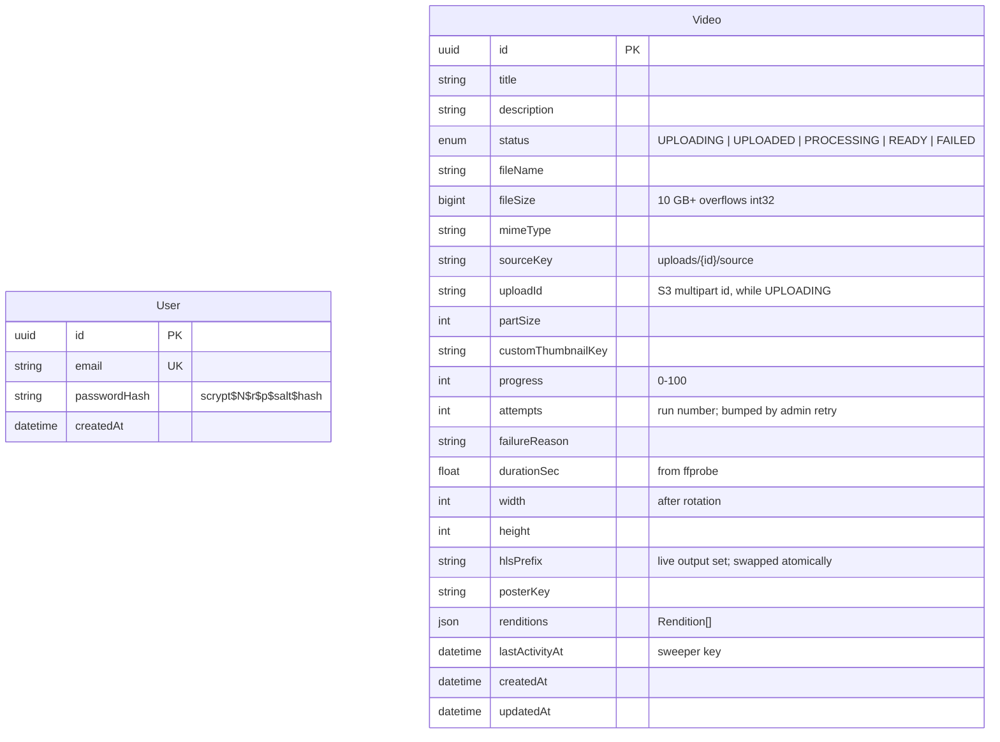
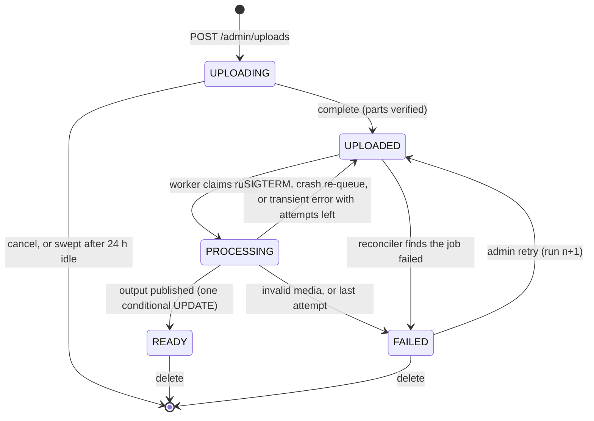

# Architecture

How the video feature is built, and why. Measured numbers come from runs on the Docker Compose stack; [TESTING.md](TESTING.md) has the test matrix and the raw measurements.

- [System overview](#system-overview)
- [Upload → process → playback](#upload--process--playback)
- [Data model](#data-model)
- [Video lifecycle](#video-lifecycle)
- [Upload](#upload-part-a)
- [Processing](#processing-part-a)
- [Playback](#playback-part-b)
- [Failure modes](#failure-modes)
- [Rejected alternatives](#rejected-alternatives)
- [Running against real AWS](#running-against-real-aws)

## System overview



Thick arrows carry video bytes. None of them pass through the API.

| Workspace | Role |
|---|---|
| `packages/contracts` | Shared zod schemas and types: DTOs, job payload and options, status transitions, part sizing, storage key layout, event shapes. Every app imports these, so a contract change breaks the build instead of production. |
| `packages/db` | Prisma schema, migrations and client. A separate workspace because both the backend and the worker write video rows. |
| `apps/backend` | Auth, upload orchestration, admin video API, public playback API, SSE, the abandoned-upload sweeper. |
| `apps/worker` | BullMQ consumer: probe, poster, HLS ladder, publish. Also runs the reconciler. |
| `apps/frontend` | Admin uploader and video list; public library and player. |

## Upload → process → playback



### HTTP API

All routes are under `/api`. Admin routes need the session cookie.

| Route | Purpose |
|---|---|
| `POST /auth/login`, `POST /auth/logout`, `GET /auth/me` | Session cookie (jose HS256 JWT, httpOnly, `SameSite=Lax`, 8 h). |
| `POST /admin/uploads` | Validate (zod), create the row and the multipart upload, return part size and count. |
| `POST /admin/uploads/:id/parts` | Sign up to 100 part URLs. |
| `GET /admin/uploads/:id` | Resume: the parts S3 already holds (ListParts, paged). |
| `POST /admin/uploads/:id/thumbnail` | Presigned POST for an optional custom thumbnail (S3 enforces 5 MiB and the content type). |
| `POST /admin/uploads/:id/complete` | Verify parts, assemble, enqueue. Idempotent. 409 lists missing or short parts; 410 if storage expired the upload. |
| `GET /admin/videos`, `GET/PATCH/DELETE /admin/videos/:id` | List, edit, delete. DELETE also cancels an upload or a running encode. |
| `POST /admin/videos/:id/retry` | FAILED → UPLOADED, new run number, new job. |
| `GET /admin/videos/events` | SSE: `changed` (status, progress) and `deleted`. |
| `GET /videos` | Public library: READY videos only. |
| `GET /videos/:id/playback` | Public playback API, for the web page and native apps (shape in `packages/contracts/src/playback.ts`). |

Example playback response (values shortened and illustrative):

```json
{
  "id": "6f1c…",
  "title": "Boiler Room Berlin",
  "description": "",
  "status": "READY",
  "progress": 100,
  "manifestUrl": "https://cdn.example.com/public/videos/6f1c…/hls/9b2e…/master.m3u8",
  "posterUrl": "https://cdn.example.com/public/videos/6f1c…/hls/9b2e…/poster.jpg",
  "durationSec": 36226.4,
  "width": 1920,
  "height": 1080,
  "renditions": [
    { "name": "1080p", "width": 1920, "height": 1080, "bandwidth": 5640800, "playlistUrl": "…/1080p/index.m3u8" },
    { "name": "720p",  "width": 1280, "height": 720,  "bandwidth": 3440800, "playlistUrl": "…/720p/index.m3u8" },
    { "name": "480p",  "width": 854,  "height": 480,  "bandwidth": 1790800, "playlistUrl": "…/480p/index.m3u8" }
  ]
}
```

A native app hands `manifestUrl` to AVPlayer or ExoPlayer and gets ABR for free. Until the video is READY, every playback field is null or empty, so one response drives the processing, failed and ready states. Admin-only fields (file name, size, source key, `failureReason`) are never in it.

## Data model



There is one table for the feature. The user isn't linked to videos because there's a single seeded admin. Indexes: `(status, lastActivityAt)` for the sweeper and reconciler, and `(status, createdAt)` for the library.

**Storage layout** (`packages/contracts/src/storage.ts`):

```
uploads/{videoId}/source                          private; presigned access only
public/videos/{videoId}/custom-thumbnail          optional admin upload
public/videos/{videoId}/hls/{runUuid}/master.m3u8
public/videos/{videoId}/hls/{runUuid}/poster.jpg
public/videos/{videoId}/hls/{runUuid}/{720p,480p,360p…}/index.m3u8
public/videos/{videoId}/hls/{runUuid}/{rendition}/seg_00000.ts …
```

**Redis:** the `video-processing` queue (jobs), the `maintenance` queue (sweeper and reconciler schedulers), and the `video-events` pub/sub channel. Redis runs with AOF and `noeviction`, so queued jobs survive a Redis restart and BullMQ keys are never evicted.

## Video lifecycle



Transitions are defined once in `@ugn/contracts` (`canTransition`). Every worker write is an `updateMany` that matches `{id, attempts: run, status in [...]}`. That **ownership rule** is what makes jobs idempotent:

- A job for a deleted video, or one superseded by an admin retry, matches nothing and completes as "skipped".
- A duplicate delivery for a READY video is also skipped.
- If a lock is lost and two copies of a run race, only one can publish. The other's heartbeat write matches nothing, so it kills ffmpeg and cleans up.

## Upload (Part A)

**Bytes never touch the API (A2).** The backend holds the S3 credentials and signs one `UploadPart` URL per part. Each URL is valid for one part number of one upload for 1 hour, and nothing else. The browser PUTs straight to storage. The API only handles small JSON requests, whatever the file size.

**Part size: 16 MiB.** A 10 GB file is 597 parts.
- Small enough that a dropped connection loses little: at most 4 in-flight parts (64 MiB). One part takes ~7 s at 20 Mbit/s.
- Big enough to keep request count low: 6 signing calls and 597 PUTs for 10 GB, and S3 charges per request.
- It grows (in whole MiB) only when a file would exceed S3's 10,000-part limit, which is past ~156 GiB. The upload size limit is 50 GiB.

**Concurrency: 4 parts in flight.** One TCP stream rarely fills a home uplink because of latency and congestion control. 4 streams saturate it, and more mostly adds contention and loses more on a pause or drop. It's an engine option.

**Resume (A3)** (`apps/frontend/src/upload/UploadEngine.ts`, unit-tested with the network injected):
- Every start, resume, or page reload goes through one path: ask the server what's stored (ListParts), keep parts whose size is exactly right, and send the rest. Pause and resume, a dropped network, and a closed tab are all the same case.
- Browsers can't reopen a file by themselves after a reload, so the admin re-selects it. localStorage keeps `{videoId, name, size, lastModified, sampleHash}`, where `sampleHash` is SHA-256 of the first and last MiB plus the size. A different file with the same name and size is refused.
- Network errors retry forever with capped (30 s), jittered backoff and a visible "reconnecting" state. The engine waits for the browser's `online` event but probes anyway every 30 s, because `navigator.onLine` can be wrong.
- A part with no progress for 45 s is aborted. A dropped Wi-Fi link often hangs instead of erroring.
- A 403 from storage (expired URL) re-signs. URLs are refreshed 5 min before they expire.
- Server errors give up after 6 attempts. A 401 stops with "Your session expired. Log in again, then resume."
- `File.slice()` is lazy, so a 10 GB file is never read into memory. Uploads use XHR rather than fetch, because only XHR reports upload progress.

**Progress, speed, ETA (A4):** progress counts bytes the server has confirmed plus bytes in flight. Speed is bytes actually sent over the last 8 s (re-sent bytes count, so it reflects the real link), and ETA is remaining bytes divided by speed.

**Completion is verified on the server.** `/complete` lists what S3 actually holds, checks every part number and size, and only then assembles the file. A 409 names the missing or short parts, and the client re-sends just those. Completion is idempotent: a repeat call returns the video, and if S3 finished but the row update crashed, the next call sees `NoSuchUpload`, checks the assembled object's size, and finishes the transition. The `UPLOADING → UPLOADED` update is conditional, so two concurrent completes can't both enqueue.

**No orphaned data (A5)**, in three layers:
1. Cancel is `DELETE /admin/videos/:id`: AbortMultipartUpload, delete `uploads/{id}/` and `public/videos/{id}/`, then the row. If storage fails, the row survives and the delete can be retried.
2. A sweeper (BullMQ job scheduler every 15 min, so one instance runs it) deletes UPLOADING videos with no activity for 24 h. Signing and status calls count as activity. 24 h survives a laptop closed overnight.
3. Storage itself aborts incomplete multipart uploads after 48 h: an S3 lifecycle rule in production, `MINIO_API_STALE_UPLOADS_EXPIRY=48h` locally. This catches anything the app misses, such as a crash between creating the S3 upload and writing the row.

**Validation (A6):**
- Client and server share zod schemas from contracts: title and description length, size up to 50 GiB, and an allowed extension (`mp4 m4v mov mkv webm avi`) with a compatible declared MIME type. Browsers often send `''` for `.mkv`, so that's accepted.
- The real check is **ffprobe in the worker**, which reads the source over a presigned URL with range requests. A renamed non-video fails without being downloaded. Also rejected: files with no video stream (audio, including audio with cover art), still images, and files with no duration or frame size.
- Invalid media becomes BullMQ's `UnrecoverableError`: FAILED at once with "Not a readable video file", and no retries.

## Processing (Part A)

**Pipeline** (`apps/worker/src/processing/video-job.runner.ts`): claim → ffprobe → disk check → download → poster → one-pass HLS encode → upload → publish. The runner is plain TypeScript with ffmpeg, S3 and the DB injected, so the whole state machine is unit-tested with fakes. `video.processor.ts` is the thin BullMQ adapter.

**Encoding choices (B1):**

| Choice | Why |
|---|---|
| **H.264 High, 8-bit `yuv420p`** | The one video codec every browser, phone, webview, TV and native player decodes in hardware. 10-bit or 4:2:2 camera files are converted, since phones often can't decode those. HEVC and AV1 save bitrate but break somewhere on this platform list. |
| **AAC-LC 128k stereo, 48 kHz** | Same reasoning: universally supported. |
| **HLS** | Native on Apple devices and in their webviews, where it's the only option on older iPhones. Plays through hls.js elsewhere, and AVPlayer and ExoPlayer take it directly. One format for every target. |
| **MPEG-TS segments** | The widest player support, including older Android and TV stacks. fMP4/CMAF pays off with HEVC, AV1 or a shared DASH package, none of which we need. |
| **6 s segments, keyframe every 2 s, `sc_threshold 0`** | 6 s is Apple's recommendation: few requests and small playlists, with quick seek and switching. Time-based keyframes (not frame counts) keep segments aligned across renditions, including variable-frame-rate phone video. |
| **Ladder: top 3 of 1080p / 720p / 480p / 360p at or below the source** | Never upscales: a 720p source gets 720/480/360. Upscaling costs encode time, storage and egress for no visible gain. Portrait video fits each rung's box in its own orientation (1080x1920 → 1080x1920 / 720x1280 / 480x854). Rotation and non-square pixels are applied first. |
| **Capped CRF 21, `maxrate` 5000/3000/1500/800k, `bufsize` 2x** | Quality-targeted (a static DJ booth uses far fewer bits than a light show), with peaks bounded so ABR works. ffmpeg writes BANDWIDTH and CODECS into the master playlist. |
| **One ffmpeg process** | Decodes once, `split`s, and runs 3 libx264 encoders into one HLS muxer (`-var_stream_map`). Decoding a 10 h source 3 times would waste hours. |
| **Preset `veryfast`** | Measured: a 14-min 1080p portrait video encodes in 9.5 min on 4 CPUs (~1.5x realtime). A real 10 h 720p video ran at ~8x realtime. Slower presets save ~10–20% bitrate for 2–3x the CPU. |

**Poster:** a frame at min(10%, 30 s), at most 1280 px wide. A custom thumbnail, if uploaded, wins. The real **duration** comes from ffprobe.

**Output is versioned (idempotency):**
- Each run writes to `public/videos/{id}/hls/{random uuid}/`, uploading segments, then variant playlists, then the master.
- One conditional UPDATE then sets READY and the new `hlsPrefix`. Players never see a half-written or mixed set, and nothing is overwritten under a URL a CDN may have cached.
- On success, sibling prefixes (from crashed runs) are deleted. On failure, the run deletes its own.
- A random id per run rather than the attempt number, because a stalled re-run keeps the same attempt number.

**Long-running BullMQ jobs (A9):**

| Concern | Setting | Why |
|---|---|---|
| Lock | `lockDuration` 120 s, renewed every 60 s | Short enough that a dead worker's job comes back in ~3 min. Started at 60 s: a full-CPU encode starved Node for 54 s, the lock lapsed and the job ran twice (harmless because of the ownership rule, but wasted CPU). Fixed by running ffmpeg at `nice -n 10` and adding margin. |
| Stalled jobs | Checked every 60 s, `maxStalledCount: 2` | A crashed worker's job is re-queued without using one of the 3 attempts. A job that crashes its worker 3 times fails instead of looping. |
| Retries | 3 attempts, exponential backoff from 30 s | For transient errors (storage blip, ffmpeg OOM-killed). The row goes back to UPLOADED with "Retrying after: …", so the UI shows Queued, not Failed. |
| Concurrency | 1 job per worker container | One ladder encode already uses the 4-CPU limit. Scale with `docker compose up --scale worker=N`; each replica has its own scratch volume. |
| Progress | Download 0–5%, encode 5–90% (ffmpeg `-progress`), upload 90–99% | Written to the row when the percentage changes, at most every 2 s and at least every 10 s, and mirrored to `job.updateProgress` and SSE. |
| Heartbeat and cancel | The 10 s progress write | If the row was deleted or retried, the write matches nothing: ffmpeg is killed and the run cleans up within ~10 s. This is how delete-during-encode works. |
| Hung ffmpeg | Killed after 60 s with no `-progress` output | Otherwise lock renewal would keep a dead encode "active" forever. |
| Clean shutdown | SIGTERM: kill ffmpeg, delete partial output, row → UPLOADED, `moveToWait` | A deploy or `docker compose stop` re-queues the job at once without using an attempt. Containers run with `init: true` (tini), because Node as PID 1 ignored the re-sent SIGTERM and every stop hung until SIGKILL. |
| Zombie rows | Reconciler every 5 min | Looks at UPLOADED/PROCESSING rows not updated for 5 min (live jobs heartbeat every 10 s). Job missing → re-enqueue. Job back in the queue while the row says PROCESSING → UPLOADED. Job failed, or completed without moving the video → FAILED with the reason. Each write also requires the row to still be stale, so it can't overwrite a worker that just picked the video up. |

**Resource bounds (one job can't take down the box):**
- **CPU:** a Compose limit of 4 CPUs, `FFMPEG_THREADS=4`, and ffmpeg at `nice 10` so the Node process keeps its lock.
- **Memory:** a 4 GB Compose limit. Measured ffmpeg RSS: ~650 MiB for a 1080p ladder. On a 10 h 720p encode it grows ~4 MiB per progress point (~730 MiB projected), probably the HLS muxer's in-memory segment lists. Node stays flat at ~135 MiB.
- **Disk:** before downloading, the worker requires free scratch space for the source + estimated output (sum of rendition caps × duration × 1.1) + 1 GiB, or the run fails as retryable. For a 10 GB / 10 h 1080p source that's ~60 GB. Scratch is a per-container anonymous volume, wiped on start (a hard crash never reaches `finally`).
- **Network:** S3 client `maxAttempts: 5`. Outputs are uploaded as buffers of a few MB each, because the SDK can't retry a stream body.

**Live status (A8):** the worker publishes small events (`changed` with status or progress, or `deleted`) on Redis pub/sub. Every backend instance relays them to admin browsers over SSE (`GET /admin/videos/events`). Progress-only events patch the list in place; anything else refetches that video. The client refetches the whole list on every (re)connect, so missed events don't matter, and it polls every 10 s while SSE is down. A 25 s heartbeat keeps proxies from closing idle streams.

**Failed videos and delete (A10):** FAILED rows show `failureReason` in the admin UI with Retry and Delete. Delete order: abort the multipart upload, delete `uploads/{id}/`, delete `public/videos/{id}/`, delete the row, then sweep `public/videos/{id}/` once more. The second sweep closes the race where a running worker uploads its last files after the first sweep. Every worker upload happens before its final row update, so the second sweep sees them all.

## Playback (Part B)

**Engine detection (B4)** (`apps/frontend/src/player/playbackMode.ts`, decided once per page):

1. `video.canPlayType('application/vnd.apple.mpegurl') !== ''` → **native HLS**. This covers Safari, every iOS browser and in-app webview (all WebKit), Android Chrome, Samsung Internet, and recent desktop Chrome, which now plays HLS natively. Native is preferred: it's the only option on older iPhones, it keeps AirPlay and the system fullscreen player, and it uses less battery than demuxing in JavaScript.
2. Else, if `(ManagedMediaSource ?? MediaSource).isTypeSupported('video/mp4; codecs="avc1.640028,mp4a.40.2"')` → **hls.js**: Firefox and older desktop Chrome/Edge. This runs before hls.js is loaded, and `Hls.isSupported()` confirms after the dynamic import.
3. Else → the **unsupported** state, which shows the stream URL for VLC.

`?player=native` or `?player=hlsjs` forces an engine when the browser supports it, so both paths can be tested in one browser. hls.js (the light build) is a separate chunk that native-HLS devices never download.

**Fast start (B2) and seeking (B3):**
- First frame needs the master playlist, one variant playlist and one 6 s segment. hls.js starts from its bandwidth estimate (`startLevel: -1`, usually a low rung) and climbs. `capLevelToPlayerSize` stops a phone-sized player from pulling 1080p.
- A 10 h variant playlist has 6,000 entries (~180 KB). It's fetched once and compresses well behind a CDN.
- Seeking fetches only the segment at the target: verified that a jump to 4:00 requested `seg_00040`/`seg_00041` and nothing in between. 07:42:10 is `seg_04621`, so seek cost doesn't depend on duration.
- hls.js buffers are capped (60 s ahead, 30 s behind). The default keeps everything played, which over a 10 h set would grow to gigabytes.
- "Jump to time" accepts `7:42:10`, `42:10`, `90` or `7h42m10s`, and so do `?t=` links. A drag on the seek bar seeks once on release, so dragging across 10 h doesn't fire hundreds of segment requests.

**Controls (B5):**
- Custom controls, because native controls differ per browser and can't host a quality menu.
- The player region is focusable and uses YouTube's keyboard shortcuts.
- The seek bar is a native `<input type=range>` with `aria-valuetext` like "7:42:10 of 10:00:00". Arrows step 5 s, PageUp/PageDown 60 s.
- The quality menu is a WAI-ARIA menu button with `menuitemradio` items.
- An `aria-live` region announces shortcut actions.
- Controls auto-hide during playback but stay visible while paused, on error, or while keyboard focus is inside.
- Optional controls drop out by the player's width (container queries), not the screen's: a portrait video on a laptop is a narrow player.

**Manual quality:** with hls.js, `hls.currentLevel`. Native players have no rendition API, so a manual pick plays that rendition's own `playlistUrl` from the same position, and Auto goes back to the master. The label ("Auto (720p)") comes from `videoWidth`/`videoHeight`, so it works with either engine.

**Mobile and webviews:**
- `playsinline` plus the legacy `webkit-playsinline` for older iOS, Instagram and Facebook webviews. No autoplay; `preload="metadata"`.
- Fullscreen uses the standard API on our container, so our controls stay. On iPhone, where only a `<video>` can go fullscreen, it uses `webkitEnterFullscreen()` and iOS's own player, which handles rotation. On Android, a landscape video locks the screen to landscape while fullscreen.
- Media Session metadata gives lock-screen controls.
- The player takes its aspect ratio from the API before anything loads, so the layout doesn't jump.

**Resume watching (B6):** localStorage keeps the 50 most recently watched videos. Position is saved every 5 s and on pause, seek, `pagehide` and visibility change, but only after real playback. Under 10 s isn't saved, and within 30 s of the end counts as finished. Every storage access is guarded, since private mode and some webviews throw. A "Resumed at 1:02:03 · Start over" chip shows on resume.

**Storage and CDN headers (B7)**, set per object by the worker so S3, MinIO and CloudFront serve them without extra config:

| Object | Content-Type | Cache-Control |
|---|---|---|
| `*.m3u8` | `application/vnd.apple.mpegurl` | `public, max-age=60` |
| `*.ts` | `video/mp2t` | `public, max-age=31536000, immutable` |
| `poster.jpg` | `image/jpeg` | `public, max-age=31536000, immutable` |
| `GET /videos/:id/playback` (READY) | JSON | `public, max-age=0, s-maxage=60` (browsers revalidate with the ETag) |
| `GET /videos/:id/playback` (otherwise) | JSON | `no-store` (the page polls it) |

Segments can be immutable because every run gets a fresh prefix. Playlists also never change in place; their 60 s TTL only bounds how long a deleted video stays on CDN edges. CORS on the bucket allows the frontend origin, which hls.js needs (it fetches with XHR). Native players don't need CORS.

**Graceful states (B9):**
- Watch page: loading skeleton, not found (unknown, malformed or deleted id), uploading / queued / processing with live % that turns into the player by itself, failed, unsupported browser, and API unreachable with Try again.
- In the player: buffering spinner, a fatal error with Try again (re-attaches at the last position), and an offline chip that auto-retries on the browser's `online` event.
- hls.js already retries and switches down by itself. The page treats only `fatal` errors as failures, and recovers fatal media errors up to twice first.

## Failure modes

| What fails | What happens | Verified |
|---|---|---|
| Wi-Fi drops mid-upload | Parts in flight fail or stall (45 s). The engine shows "reconnecting" and retries with backoff. Stored parts aren't re-sent; at most 64 MiB is lost. | Retry logic unit-tested; the 45 s stall timer (`xhrPutPart.ts`) isn't; not yet in a real browser |
| Tab closed or refreshed | Resume card from localStorage. Re-select the file, ListParts, send the rest. | Chrome: 1 GiB resumed from 31.3%, SHA-256 matched |
| Part URL expires | 403 → re-sign. URLs are refreshed 5 min before expiry anyway. | Unit tests |
| Session expires mid-upload (uplink below ~2.8 Mbit/s for 10 GB) | 401 → "Log in again, then resume". Stored parts are kept. | Engine message unit-tested; not tested in a browser |
| Upload abandoned | Swept after 24 h idle; storage backstop at 48 h. | Unit tests (sweeper) |
| Renamed non-video | ffprobe fails, FAILED at once, no retries. | E2E |
| Worker SIGKILL / OOM / host loss | Lock lapses (120 s), job re-queued without using an attempt, scratch wiped on start, encode restarts from 0. | SIGKILL at 25% → READY |
| Worker SIGTERM (deploy) | ffmpeg killed, partial output deleted, job re-queued at once, no attempt used. | ×3, including twice on the 10 h job |
| Job lost from Redis | Reconciler re-enqueues it within ~5–10 min. | Job removed by hand → READY |
| Lock lost, two copies run | Ownership rule: only one publishes; the other stops on its next heartbeat. | Seen with the 60 s lock (before the fix) |
| Video deleted during encode | Heartbeat matches nothing; ffmpeg killed within ~10 s; second sweep removes late uploads. | Manual, at 15% |
| Transient storage error | 3 attempts, backoff 30 s / 60 s; the UI shows Queued. Last attempt → FAILED with the reason; admin retry. | Unit tests |
| Scratch disk too small | Pre-flight check fails the run as retryable. Docker Desktop reports the VM's sparse disk, so the check can pass on a Mac that then fills up. | Unit tests |
| Viewer goes offline | Plays from buffer, offline chip, resumes on reconnect. | Headless Chrome |
| CDN or segment blocked | hls.js retries, then error with Try again; native errors at once. | Headless Chrome |

## Rejected alternatives

| Rejected | Chosen | Why |
|---|---|---|
| Upload through the API (streaming proxy) | Presigned S3 multipart | A2 forbids it, and 10 GB through Node means hours of open connections per upload and a bandwidth bill on the API tier. |
| tus / Uppy Companion | Plain S3 multipart + our engine | tus needs a server that receives the bytes (or a Companion proxy). S3 multipart already has resumable semantics (ListParts) and works unchanged on real S3. |
| Presigned single PUT | Multipart | 5 GB maximum per PUT, and a drop restarts from 0. |
| Re-hashing the whole file to fingerprint it on resume | Name + size + lastModified + SHA-256 of the first and last MiB | Hashing 10 GB in the browser takes minutes. Sampling catches the realistic mistake (a different file with the same name) instantly. |
| Smaller parts (5–8 MiB), or bigger (64–100 MiB) | 16 MiB | Smaller: 1,200–2,000 parts for 10 GB, more signing calls and requests. Bigger: a drop wastes up to 400 MiB with 4 in flight, and each part takes ~40 s on a 20 Mbit/s uplink, so progress is coarse. |
| WebSockets for status | SSE + Redis pub/sub | One-way is enough. SSE is plain HTTP (cookies and proxies just work), and `EventSource` reconnects by itself. |
| Polling only | SSE with polling fallback | Polling every few seconds per admin tab is wasteful, and laggy at longer intervals. |
| Separate ffmpeg pass per rendition | One pass, `split` | Decoding a 10 h source three times. |
| fMP4 / CMAF segments | MPEG-TS | Only pays off with HEVC/AV1 or shared DASH packaging. TS is the safest choice for old Android and TV players. |
| HEVC or AV1 renditions | H.264 only | 30–50% smaller, but no hardware decode on many Android phones, and no AV1 on most iPhones. An HEVC ladder could be added alongside later for egress savings. |
| 2 s or 10 s segments | 6 s | 2 s: 18,000 segments per rendition for 10 h, and 3x the requests. 10 s: slower start and coarser switching. |
| Upscaling to always produce 1080p | Never upscale | Costs encode time, storage and egress for no visible gain. |
| Writing over `v{attempt}/` | Random prefix per run, pointer swap | A stalled re-run keeps the same attempt number, and overwriting under a cached URL serves mixed sets from the CDN. |
| AWS MediaConvert, or a video SaaS | Self-hosted ffmpeg in BullMQ | SaaS is ruled out by the brief. MediaConvert costs ~18x more at this volume (see W3); it's the right call for bursty load or no ops capacity. |
| BullMQ sandboxed processors | In-process runner, ffmpeg as a child process | ffmpeg already runs in its own process. A sandbox would add IPC around a job whose heavy work is out of process anyway. |
| hls.js everywhere | Native HLS first | No MSE in iPhone Safari before iOS 17.1, nor in most in-app webviews. Native also keeps AirPlay and saves battery. |
| Native `<video controls>` | Custom controls | Differs per browser, and can't host a quality menu or our keyboard and screen-reader behaviour. |
| `minio/minio` image | `bitnamilegacy/minio` (pinned) | The official images are gone from Docker Hub and quay.io needs a login. Production uses real S3, so this only affects local dev. |
| Prisma 7 / jose 6 | Prisma 6 / jose 5 | Both still ship CommonJS, which NestJS compiles to. |

## Running against real AWS

The code needs only env changes; the AWS resources themselves are not provisioned by this repo.

- **Env:** unset `S3_ENDPOINT` and `S3_PUBLIC_ENDPOINT`, set `S3_FORCE_PATH_STYLE=false`, `S3_REGION`, `S3_BUCKET`, and either keys or an IAM role. Set `PUBLIC_MEDIA_BASE_URL=https://<cloudfront-domain>`, `COOKIE_SECURE=true`, a real `JWT_SECRET`, and `CORS_ORIGINS`.
- **Bucket:** private, with CloudFront Origin Access Control granting `s3:GetObject` on `public/*` only. `uploads/` is never reachable through the CDN.
- **Bucket CORS:** allow `PUT` from the admin origin (for part uploads) and `POST` (for the thumbnail). Allow `GET`/`HEAD` from the public origin, or let CloudFront answer CORS with a response headers policy.
- **Lifecycle rule:** `AbortIncompleteMultipartUpload` after 2 days on `uploads/` (the A5 backstop).
- **CloudFront:** a cache policy that respects origin `Cache-Control` (the worker sets it per object), gzip/brotli for `.m3u8`, and `Origin` in the cache key if CloudFront answers CORS.
- **Worker:** EC2 or ECS with a scratch volume sized for the largest video (~60 GB for 10 h at 1080p), and 4 vCPU / 4–8 GB per worker.
